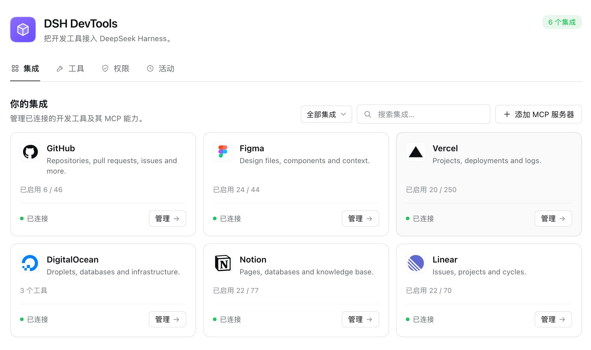

# DSH DevTools

[中文](./README.md) · **English**

[](https://github.com/lukema95/dsh-devtools)
[](https://www.npmjs.com/package/@lukema/dsh-devtools)
[](./LICENSE)
[](https://github.com/lukema95/dsh-devtools/actions/workflows/test.yml)

> Open source under the MIT License. Not affiliated with GitHub, Figma, Vercel,
> DigitalOcean, Notion or Linear. This is an early 0.x project; plugin APIs and
> configuration may change.

Developer tool integrations for DeepSeek Harness. Connect GitHub, Figma, Vercel,
DigitalOcean, Notion and Linear as MCP servers, then manage their tools,
permissions and call history from one panel inside DSH.



npm: [`@lukema/dsh-devtools`](https://www.npmjs.com/package/@lukema/dsh-devtools)  
Project: [github.com/lukema95/dsh-devtools](https://github.com/lukema95/dsh-devtools)  
Issues: [GitHub Issues](https://github.com/lukema95/dsh-devtools/issues)

The plugin adds a **DevTools** entry to the DSH sidebar and a global panel in the
main column. It is four tabs plus two detail views:

- **Integrations** — provider cards with connection status, tool counts and
  connect/manage actions. Custom streamable-HTTP MCP servers can be added.
- **Integration details** — connection facts, capabilities, per-provider tool
  switches, permission policies and that provider's activity.
- **Tools** — every discovered MCP tool, grouped by provider, with search,
  enable/disable switches, a recommended set for large catalogs and a tool
  detail dialog.
- **Tool details** — the tool's input schema, a generated argument form and a real
  test call through the same execution pipeline the agent uses.
- **Permissions** — per-tool `auto` / `ask` / `block` policies, write-approval
  switches and three one-click profiles (read only, standard, unattended).
- **Activity** — the last 200 MCP calls with status, duration, redacted arguments
  and result summaries.

## Requirements

- DSH Desktop or DSH CLI with the default `web` or `desktop` profile;
- DSH `>= 0.2.2-rc.1`; the profile must mount
  `@deepseek-ai/dsh-mcp-manager` and the local credential provider;
- Node `^22.19.0 || >=24.0.0` for running the test suite from source;
- No build step and no runtime npm dependencies.

## Install

### From npm (recommended)

```bash
dsh plugin --profile desktop add @lukema/dsh-devtools
```

Use `web` instead of `desktop` for the Web profile. Restart DSH, then open
**DevTools** in the sidebar.

Pin a version when needed:

```bash
dsh plugin --profile desktop add @lukema/dsh-devtools@0.1.0
```

### From GitHub

```bash
dsh plugin --profile desktop add github:lukema95/dsh-devtools
```

### From the DSH UI

1. Open **Plugins** in the DSH sidebar.
2. Choose **Add plugin**, then **Install a third-party plugin**, and enter the
   absolute path to this directory.
3. Enable the bundle and open **DevTools** in the sidebar.

### From source (development)

```bash
git clone https://github.com/lukema95/dsh-devtools.git
cd dsh-devtools
npm test
dsh plugin --profile desktop add link:$(pwd)
```

Restart DSH after installing. Changes under `host/` or `client.js` require a
plugin reload or a DSH restart.

There is no build step: `index.js` and `client.js` are the runtime files, and the
host half imports only Node built-ins.

## Development and tests

```bash
npm test
```

Tests use a temporary `DSH_HOME`, so they never read or write real provider
configuration or credentials. The four test files cover the host lifecycle, the
recommended tool selection, OAuth refresh and client registration.

Repository layout:

```text
host/plugin.js      host lifecycle, providers, tool governance and API
host/oauth.js       OAuth discovery, DCR, PKCE, callback and refresh
host/selection.js   recommended tool set and usage logic
host/presets.js     built-in provider definitions
host/state.js       local state validation and migration
client.js           DevTools UI
test/               host, selection, OAuth and client tests
```

## Connect a provider

Each provider uses the authentication route its own MCP server supports:

| Provider | Route |
|---|---|
| **GitHub** | Personal access token (classic or fine-grained) |
| **Figma** | Official remote MCP over browser OAuth (temporary compatibility client) |
| **Vercel, DigitalOcean, Notion, Linear** | Browser OAuth |
| Custom server | Optional bearer token |

### GitHub — personal access token

Open **GitHub → Connect** and paste a token from
[GitHub settings → Tokens](https://github.com/settings/tokens). The dialog lists
the recommended scopes (`repo`, `read:org`, `read:user`, `user:email`,
`read:packages`, `write:packages`, `read:project`, `project`, `gist`,
`notifications`). The token is stored in DSH's credential provider under
`DSH_DEVTOOLS_GITHUB` and referenced by the MCP entry as
`${credential:DSH_DEVTOOLS_GITHUB}`; the page never reads it back.

GitHub's remote MCP server has no dynamic client registration, so this plugin
does not run a GitHub OAuth flow. Use a PAT or register a GitHub App/OAuth App
out of band.

The connect dialog stays open until the MCP server has actually connected. A
bad token shows the server error inline, so it can be replaced and retried
without disconnecting first.

### Figma — official remote MCP (temporary compatibility client)

Figma's official MCP server is `https://mcp.figma.com/mcp`, but Figma currently
only admits clients on its own MCP catalog. Until DSH is added, this plugin uses
a temporary compatibility identity when registering its OAuth client. This keeps
the official remote server working without a desktop app or Dev Mode, but it is a
Figma policy workaround and can stop working when Figma changes the allowlist.

- Choose **Figma → Sign in** and approve the browser OAuth page.
- The dialog warns that Figma may show a different client name; that is the
  temporary compatibility identity.
- The plugin stores the access token as a credential ref and the refresh token,
  client secret and registration in a `dsh-devtools/figma` grant record. Nothing
  is written to `cordis.patch.yml`.
- Reading works on normal plans. **Writing to Figma may require a Full seat**.
- The recommended tool set starts read-only; enable the write tools you need in
  the Tools tab, or let the agent search and enable them.

No Figma desktop app, Dev Mode, or desktop MCP server is used.

### Vercel, DigitalOcean, Notion, Linear — browser OAuth

Choose a provider and click **Sign in with …**. A browser tab opens the
provider's consent page; after approval, DSH receives the code on a loopback
callback and stores the access token in the credential provider. The MCP entry
reads it through `${credential:DSH_DEVTOOLS_<PROVIDER>}`, and the plugin refreshes
it before expiry. Refresh tokens and the dynamically registered OAuth client are
kept in a credential GrantRecord, never in the page.

The flow uses OAuth 2.1 authorization code + PKCE + state, with dynamic client
registration where the provider offers it. The callback listens on
`127.0.0.1` only (RFC 8252). If a browser blocks the tab, the dialog offers the
authorization link for manual opening.

DigitalOcean, Linear and Vercel also accept an API token; the dialog offers
**Use an access token instead** as a fallback. Notion is OAuth-only.

Custom servers are added with **Add MCP server**: a name, an `http(s)` endpoint
and an optional token. They behave like built-ins and can be removed again.

## Tool context budget

A server such as Vercel publishes 200+ tools. Sending every schema on every
request can cost more than the task, so this plugin does not enable a large
catalog wholesale:

- A provider with **30 or fewer tools** keeps all its tools enabled.
- A provider with **more than 30 tools** starts with a cold-start **recommended set
  of up to 20 read-only tools**, chosen by resource relevance (projects,
  deployments, logs, errors, domains, environments, …). While discovery settles,
  those tools stay hidden rather than being enabled wholesale for a moment.
- After the agent has actually called tools, the recommended set is rebuilt from
  **call frequency**: tools used at least three times become the base (writes
  included), a few common reads cover new tasks, and unused tools stay hidden.
  There is no fixed count for that usage-derived set; a 16k-token safety ceiling
  prevents an unexpectedly huge catalog. It is recomputed on reconnect/restart or
  when you press **Refresh recommended**, never in the middle of a model step.
- Provider cards show `enabled / total`; the Tools tab shows the approximate
  schema tokens of the enabled set.
- **Refresh recommended** recomputes the set from current usage; **Enable all**
  asks for confirmation and shows the extra token cost; **Disable all** removes
  the provider's schemas entirely.
- New tools discovered in recommended/custom mode stay disabled until enabled.
- Usage counts live in the plugin's local state and never leave the machine.

Disabling a tool removes its schema from each agent's request. **Permissions →
Block** only denies calls; it does not remove the schema, so use Tools →
Disable when the goal is context size.

Providers configured by an earlier version are migrated to the recommended set
the first time their tool catalog is discovered.

The agent is not limited to the recommended set. Two small plugin tools let it
discover and opt in to hidden tools without injecting the whole catalog:

- `devtools_search_tools` searches all tools from connected providers, including
  disabled ones, and reports provider, risk, policy and enabled state.
- `devtools_enable_tool` enables one tool by exact name. The tool becomes visible
  on the next model step and its normal permission policy still applies. An
  agent can add at most 40 enabled tools per provider; beyond that the user must
  review the Tools tab.

These two tools cost a few hundred tokens; the alternative (200 Vercel schemas)
costs tens of thousands.

## How governance is enforced

Every MCP tool exposed by a connected server is named
`mcp__<provider>__<tool>`. The plugin governs those names at the runtime layer,
not only in the UI:

- Disabled tools are removed from each agent's tool set with
  `ctx.tools.restrict()` on that agent's own context, so their schemas leave the
  request too. The mask is reapplied when tools connect, disconnect, or change.
- `ctx.tools.guard()` still denies calls to disabled tools, and to tools whose
  policy is `block`. A guard denial cannot be overridden by another plugin.
- A `tools/pre-execute` waterfall answers the tool approval request (`ask`) for
  policies that require confirmation, with an English and Chinese prompt.
- Programmatic calls without an agent, including the in-page tester, bypass the
  agent policy so you can debug a tool that the agent is not allowed to call.
- `tools/result` feeds the activity log; arguments and error text are redacted
  before they are stored.

Risk is inferred from the tool name and description. A name starting with a read
verb (`get`, `list`, `search`, …) is treated as a read unless it also contains a
destructive verb (`delete`, `destroy`, `drop`, …). Everything is overridable on
the **Permissions** page. Inference is a heuristic, not a security boundary:
review the dangerous tools your servers publish before allowing writes.

A tool switch affects two layers: an enabled tool is visible and callable; a
disabled tool is hidden from each agent's request (less context) and denied if a
call is somehow dispatched. Policy changes apply to the agent's next step.

## Data and privacy

- Provider choices, tool switches, policies, usage counts and activity live in
  `$DSH_HOME/devtools/state.json`, written atomically with owner-only
  permissions. Use **Integrations → Danger zone → Reset DevTools data** to clear
  them together with stored credentials.
- Tokens live in the credential provider (`$DSH_HOME/.credentials.yaml`), never
  in the plugin's state or in the browser. Disconnect keeps them; Reset removes
  them.
- OAuth refresh tokens, client secrets and client registrations live in
  `dsh-devtools/*` GrantRecords through DSH's recommended `modifyRecord()` path;
  access tokens and PATs use credential refs.
- The page talks to one owner-only route, `POST /api/dsh-devtools`. DSH's
  connection layer rejects non-owner peers before the handler runs.
- Activity keeps 200 calls and stores redacted arguments and truncated results.

## Uninstall and cleanup

Uninstalling the bundle does **not** delete the plugin's state or credentials.
This is not the plugin avoiding cleanup: DSH currently has no separate per-plugin
uninstall hook. Uninstall, disable, reload and restart all go through the plugin
lifecycle, so the plugin cannot reliably distinguish "remove this plugin" from
"temporarily disable it" or "restart DSH". Deleting credentials in `dispose`
would sign the user out on every disable or restart.

Cleanup is therefore an explicit operation, not an uninstall side effect.
Automatic uninstall cleanup needs a host-level uninstall confirmation or hook;
until DSH provides one, Reset is the user-controlled cleanup path.

If you are only upgrading or reinstalling, **do not Reset**: keeping state and
credentials lets the plugin reconnect immediately. If you are moving machines,
handing over the device, or retiring these integrations, use
**Integrations → Danger zone → Reset DevTools data** before uninstalling. It
disconnects every provider, removes `DSH_DEVTOOLS_*` refs and
`dsh-devtools/*` credential records, revokes OAuth tokens where the provider
supports RFC 7009, and clears `state.json`.

If the plugin is already removed, stop DSH and remove the leftovers manually:

- `~/.dsh/devtools/state.json`
- `DSH_DEVTOOLS_*` entries in `~/.dsh/.credentials.yaml`
- `dsh-devtools/*` grant records in the same file

Also revoke the authorization in the provider's dashboard; removing local
tokens cannot revoke a grant that the provider still considers active.

## Limitations

- One account per provider. Multi-account and multi-workspace connections are not
  implemented.
- GitHub uses a PAT; GitHub OAuth needs a pre-registered app and is not built in.
- Figma uses the official remote MCP server through a temporary compatibility
  client; Figma may change its allowlist at any time. Writing may require a Full
  seat.
- Browser OAuth assumes the DSH Host's loopback interface is reachable from the
  browser. A Host running in a container or on another machine needs its own
  callback deployment.
- Streamable HTTP transport only; stdio MCP servers are configured through DSH
  Settings instead of this page.
- Provider names are reserved (`github`, `figma`, …). A server configured in DSH
  Settings under the same name makes that integration fail to register with a
  duplicate-name error.
- DSH Desktop's default credential provider is a 0600 YAML file; processes
  running as the same OS user, including agent tool processes, can read it. It
  is not an OS keychain isolation boundary.
- Risk inference is name/description based, and tool annotations are not
  consumed.
- Policies are global per tool. Per-project scoping, time-limited grants, and
  role profiles (frontend/backend/DevOps) are not implemented; the three
  profiles on the Permissions page are risk-based.
- Connection status is refreshed by a 2.5-second poll while the panel is open.
- Disconnecting only closes the connection and keeps the stored OAuth session or
  PAT for a quick reconnect. Reset DevTools data removes every credential and
  revokes OAuth tokens where the provider supports RFC 7009.

## Contributing

Issues and pull requests are welcome. Read [CONTRIBUTING.md](./CONTRIBUTING.md)
first and run `npm test` before opening a PR.

Do not include tokens, OAuth codes, client secrets or complete credential files
in issues, PRs, screenshots or logs.

## Security

Report security issues privately through
[GitHub Security Advisories](https://github.com/lukema95/dsh-devtools/security/advisories/new),
not in a public issue. See [SECURITY.md](./SECURITY.md).

The Figma integration currently uses a temporary compatibility identity to pass
Figma's MCP client allowlist. This is a policy workaround, not an official Figma
integration; review Figma's terms and account risk before enabling it.

## License

[MIT](./LICENSE) © 2026 lukema95 and DSH DevTools contributors.

## Disclaimer

This project is not affiliated with or endorsed by GitHub, Figma, Vercel,
DigitalOcean, Notion or Linear. Third-party names and trademarks belong to their
respective owners.

Third-party MCP servers control their capabilities, permissions and availability.
The Figma compatibility client, write operations and OAuth policies may change
without notice; evaluate the risks before using them.
