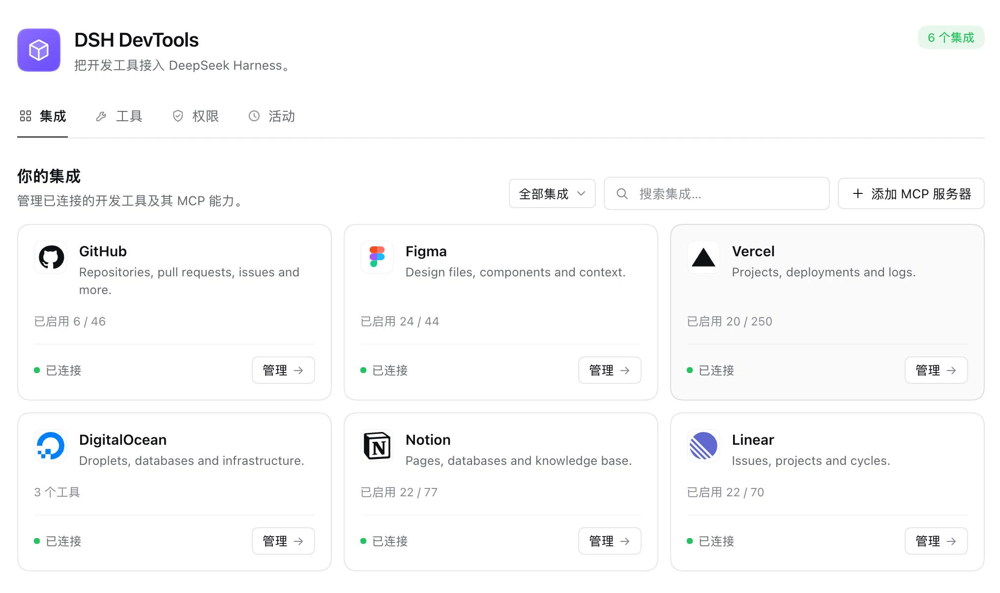

# DSH DevTools

**中文** · [English](./README.en.md)

[](https://github.com/lukema95/dsh-devtools)
[](https://www.npmjs.com/package/@lukema/dsh-devtools)
[](./LICENSE)
[](https://github.com/lukema95/dsh-devtools/actions/workflows/test.yml)

> 开源项目，MIT License。非 GitHub、Figma、Vercel、DigitalOcean、Notion 或
> Linear 的官方项目。当前为 0.x 早期版本，插件 API 和配置可能变化。

DeepSeek Harness 的开发者工具集成。把 GitHub、Figma、Vercel、DigitalOcean、
Notion 和 Linear 作为 MCP server 接入，然后在 DSH 的一个面板里统一管理工具、
权限和调用历史。



npm：[`@lukema/dsh-devtools`](https://www.npmjs.com/package/@lukema/dsh-devtools)  
项目主页：[github.com/lukema95/dsh-devtools](https://github.com/lukema95/dsh-devtools)  
问题反馈：[GitHub Issues](https://github.com/lukema95/dsh-devtools/issues)

插件会在 DSH 侧边栏增加 **DevTools** 入口，并在主区域打开全局面板。面板包含
四个标签页和两个详情视图：

- **集成** — provider 卡片，展示连接状态、工具数量和连接/管理操作。也可以添加
  自定义 streamable-HTTP MCP server。
- **集成详情** — 连接信息、能力、该 provider 的工具开关、权限策略和调用活动。
- **工具** — 所有已发现的 MCP 工具，按 provider 分组，支持搜索、启用/禁用、
  大目录的推荐集，以及工具详情对话框。
- **工具详情** — 工具输入 schema、自动生成的参数表单，以及通过 Agent 相同执行
  链路发起的真实测试调用。
- **权限** — 每个工具的 `auto` / `ask` / `block` 策略、写入审批开关，以及三个
  一键配置（只读、标准、无人值守）。
- **活动** — 最近 200 次 MCP 调用，包含状态、耗时、脱敏参数和结果摘要。

## 环境要求

- DSH Desktop 或 DSH CLI，使用默认的 `web` 或 `desktop` profile；
- DSH `>= 0.2.2-rc.1`，profile 需要挂载 `@deepseek-ai/dsh-mcp-manager` 和本地
  凭据提供方；
- 从源码运行测试需要 Node `^22.19.0 || >=24.0.0`；
- 没有构建步骤，也没有运行时 npm 依赖。

## 安装

### 从 npm 安装（推荐）

```bash
dsh plugin --profile desktop add @lukema/dsh-devtools
```

使用 Web profile 时把 `desktop` 换成 `web`。安装后重启 DSH，在侧边栏打开
**DevTools**。

需要固定版本时：

```bash
dsh plugin --profile desktop add @lukema/dsh-devtools@0.1.0
```

### 从 GitHub 安装

```bash
dsh plugin --profile desktop add github:lukema95/dsh-devtools
```

### 通过 DSH 界面安装

1. 打开 DSH 侧边栏的 **Plugins**。
2. 选择 **Add plugin**，再选 **Install a third-party plugin**，填入本目录的绝对路径。
3. 启用 bundle，然后在侧边栏打开 **DevTools**。

### 从源码安装（开发）

```bash
git clone https://github.com/lukema95/dsh-devtools.git
cd dsh-devtools
npm test
dsh plugin --profile desktop add link:$(pwd)
```

安装后重启 DSH。修改 `host/` 或 `client.js` 后需要重新加载插件或重启 DSH。

没有构建步骤：`index.js` 和 `client.js` 就是运行时文件，Host 侧只引用 Node 内置
模块。

## 开发与测试

```bash
npm test
```

测试使用临时的 `DSH_HOME`，不会读写真实的 provider 配置或凭据。四个测试文件分别
覆盖 Host 生命周期、推荐工具选择、OAuth 刷新和客户端注册。

项目结构：

```text
host/plugin.js      Host 生命周期、provider、工具治理和 API
host/oauth.js       OAuth 发现、动态注册、PKCE、回调和刷新
host/selection.js   推荐工具集和 usage 相关逻辑
host/presets.js     内置 provider 定义
host/state.js       本地状态校验和迁移
client.js           DevTools UI
test/               Host、选择、OAuth 和客户端测试
```

## 连接 provider

每个 provider 使用其 MCP server 支持的身份验证方式：

| Provider | 方式 |
|---|---|
| **GitHub** | Personal access token（classic 或 fine-grained） |
| **Figma** | 官方远程 MCP + 浏览器 OAuth（临时兼容客户端） |
| **Vercel、DigitalOcean、Notion、Linear** | 浏览器 OAuth |
| 自定义 server | 可选 bearer token |

### GitHub — Personal access token

打开 **GitHub → Connect**，粘贴
[GitHub settings → Tokens](https://github.com/settings/tokens) 创建的 token。
对话框会列出推荐 scope（`repo`、`read:org`、`read:user`、`user:email`、
`read:packages`、`write:packages`、`read:project`、`project`、`gist`、
`notifications`）。Token 会存入 DSH 的凭据提供方，引用名为
`DSH_DEVTOOLS_GITHUB`，MCP 条目通过 `${credential:DSH_DEVTOOLS_GITHUB}` 读取；
页面不会回读 token 明文。

GitHub 远程 MCP server 不支持动态客户端注册，因此本插件不执行 GitHub OAuth
流程。请使用 PAT，或在外部自行注册 GitHub App/OAuth App。

连接对话框会保持打开，直到 MCP server 真正连接成功。Token 有问题时，server
错误会直接显示在对话框内，可以替换 token 后重试，不需要先断开。

### Figma — 官方远程 MCP（临时兼容客户端）

Figma 官方 MCP server 是 `https://mcp.figma.com/mcp`，但 Figma 目前只允许其
MCP catalog 中的客户端接入。在 DSH 被加入之前，本插件注册 OAuth 客户端时会
使用一个临时兼容身份。这样不需要 Figma 桌面应用或 Dev Mode 就能使用官方远程
server，但这是对 Figma 策略的变通方案，Figma 调整 allowlist 后可能失效。

- 选择 **Figma → Sign in**，在浏览器里确认 OAuth 授权页。
- 对话框会提示 Figma 可能显示不同的客户端名称；那就是临时兼容身份。
- 插件把 access token 存为 credential ref，把 refresh token、client secret 和
  client registration 存进 `dsh-devtools/figma` grant record。不会写入
  `cordis.patch.yml`。
- 普通计划可以读取。**写入 Figma 可能需要 Full 席位**。
- 推荐工具集默认只启用只读工具；需要写入时，在 **工具** 标签页开启写工具，或让
  Agent 搜索并开启。

不需要 Figma 桌面应用、Dev Mode 或 desktop MCP server。

### Vercel、DigitalOcean、Notion、Linear — 浏览器 OAuth

选择 provider，点击 **Sign in with …**。浏览器会打开 provider 的授权页；确认后，
DSH 通过 loopback 回调拿到 code，并把 access token 存入凭据提供方。MCP 条目通过
`${credential:DSH_DEVTOOLS_<PROVIDER>}` 读取，插件会在过期前自动刷新。Refresh
token 和动态注册的 OAuth client 保存在 credential GrantRecord 中，不会进入页面。

流程使用 OAuth 2.1 authorization code + PKCE + state；provider 支持时会使用动态
客户端注册。回调只监听 `127.0.0.1`（RFC 8252）。如果浏览器拦截了标签页，对话框
会提供授权链接供手动打开。

DigitalOcean、Linear 和 Vercel 也支持 API token，对话框提供
**Use an access token instead** 作为后备。Notion 只支持 OAuth。

自定义 server 通过 **Add MCP server** 添加：名称、`http(s)` endpoint 和可选的
token。它们的行为与内置 provider 一致，也可以随时移除。

## 工具上下文预算

像 Vercel 这样的 server 会发布 200+ 个工具。每次请求都发送所有 schema，成本可能
超过任务本身，因此插件不会整体启用大目录：

- **30 个或更少工具**的 provider 会全部启用。
- **超过 30 个工具**的 provider 首次会启用一套冷启动**推荐集，最多 20 个只读
  工具**，按资源相关性选择（projects、deployments、logs、errors、domains、
  environments 等）。在发现过程稳定前，这些工具保持隐藏，不会短暂地全部启用。
- Agent 实际调用过工具后，推荐集会按**调用频率**重建：调用至少三次的工具成为
  基础集（包含写入工具），少量常用只读工具覆盖新任务，未使用的工具保持隐藏。
  使用历史生成后没有固定数量；16k token 的安全上限会防止异常大的目录。推荐集会在
  重连/重启或点击 **Refresh recommended** 时重算，不会在模型步骤中途改变。
- Provider 卡片显示 `已启用 / 总数`；**工具** 标签页显示已启用集合的近似 schema
  token 数。
- **Refresh recommended** 按当前使用情况重算；**Enable all** 会先确认并显示额外
  token 成本；**Disable all** 会完全移除该 provider 的 schema。
- 在推荐/自定义模式下新发现的工具默认禁用，直到手动启用。
- 使用次数保存在插件本地状态中，不会离开本机。

禁用一个工具会从每个 Agent 的请求中移除它的 schema。**权限 → Block** 只拒绝调用，
不会移除 schema；如果目标是减少上下文，请使用 **工具 → 禁用**。

早期版本配置的 provider 会在首次发现工具目录时迁移到推荐集。

Agent 不限于推荐集。两个小型插件工具让它可以发现并按需启用隐藏工具，而不必注入
整个目录：

- `devtools_search_tools` 搜索所有已连接 provider 的工具（包括禁用工具），并报告
  provider、风险、策略和启用状态。
- `devtools_enable_tool` 按精确名称启用一个工具。工具会在下一个模型步骤可见，正常
  权限策略仍然生效。每个 provider 最多由 Agent 启用 40 个工具；超过后必须由用户
  在工具页审核。

这两个工具只消耗几百 token；替代方案（200 个 Vercel schema）会消耗数万 token。

## 治理如何生效

连接 server 暴露的每个 MCP 工具名都是 `mcp__<provider>__<tool>`。插件在运行时层
治理这些名称，而不只是在 UI 中限制：

- 禁用的工具会通过该 Agent 自己 context 上的 `ctx.tools.restrict()` 从其工具集中
  移除，因此 schema 也会离开请求。工具连接、断开或变化时会重新应用 mask。
- `ctx.tools.guard()` 仍会拒绝禁用工具和策略为 `block` 的工具调用。其他插件无法
  覆盖 guard 的拒绝。
- `tools/pre-execute` waterfall 会为需要确认的 `ask` 策略返回审批请求，并提供中英文
  提示。
- 不带 Agent 的程序化调用（包括页面内测试器）会绕过 Agent 策略，方便调试 Agent
  无权调用的工具。
- `tools/result` 写入活动日志；参数和错误文本在存储前会脱敏。

风险根据工具名称和描述推断。以读取动词（`get`、`list`、`search` 等）开头的名称
默认视为只读，除非同时包含破坏性动词（`delete`、`destroy`、`drop` 等）。所有判断
都可以在 **权限** 页覆盖。推断只是启发式规则，不是安全边界：允许写入前，请审核
server 发布的危险工具。

工具开关影响两层：启用的工具可见且可调用；禁用的工具会从每个 Agent 的请求中隐藏
（减少上下文），即使调用被派发也会被拒绝。策略变更在 Agent 的下一个步骤生效。

## 数据与隐私

- Provider 选择、工具开关、策略、使用次数和活动保存在
  `$DSH_HOME/devtools/state.json`，以仅 owner 可读的权限原子写入。使用
  **集成 → Danger zone → Reset DevTools data** 可以连同已存凭据一起清除。
- Token 保存在凭据提供方（`$DSH_HOME/.credentials.yaml`），不会进入插件状态或
  浏览器。断开连接会保留 token；Reset 会移除它们。
- OAuth refresh token、client secret 和 client registration 保存在
  `dsh-devtools/*` GrantRecord 中，使用 DSH 官方推荐的 `modifyRecord()` 记录
  路径；access token 和 PAT 使用 credential refs。
- 页面只与一个 owner-only 路由通信：`POST /api/dsh-devtools`。DSH 的连接层会在
  handler 执行前拒绝非 owner 对端。
- 活动最多保留 200 次调用，存储脱敏参数和截断后的结果。

## 卸载与清理

卸载 bundle **不会**删除插件状态或凭据。这不是插件“偷懒”，而是当前 DSH 没有
独立的 per-plugin 卸载钩子：卸载、禁用、重载和重启都会走插件生命周期，插件无法
可靠区分“用户要卸载”与“只是临时禁用/重启”。如果在 `dispose` 里删除凭据，用户
每次禁用插件或重启 DSH 都会被登出。

因此插件把清理做成显式操作，而不是卸载副作用。真正的“卸载时自动清理”需要宿主
提供独立的卸载确认或 hook；在此之前，需要清除凭据时由用户主动 Reset。

如果只是升级或重装插件，**不需要 Reset**：保留 state 和凭据可以直接恢复。
如果要换机、交出设备或不再使用这些集成，请在卸载前使用
**集成 → Danger zone → Reset DevTools data**。它会断开所有 provider，移除
`DSH_DEVTOOLS_*` refs 和 `dsh-devtools/*` 凭据记录，在 provider 支持 RFC 7009
时撤销 OAuth token，并清空 `state.json`。

如果插件已经被移除，请先停止 DSH，再手动清理：

- `~/.dsh/devtools/state.json`
- `~/.dsh/.credentials.yaml` 中的 `DSH_DEVTOOLS_*` 条目
- 同一文件中的 `dsh-devtools/*` grant 记录

同时请在 provider 后台撤销授权；只删除本地 token 无法撤销 provider 仍认为有效的
grant。

## 限制

- 每个 provider 只支持一个账号；多账号和多 workspace 连接尚未实现。
- GitHub 使用 PAT；GitHub OAuth 需要预先注册应用，未内置。
- Figma 通过临时兼容客户端使用官方远程 MCP server；Figma 可能随时调整 allowlist。
  写入可能需要 Full 席位。
- 浏览器 OAuth 假设 DSH Host 的 loopback 接口可从浏览器访问。Host 运行在容器或
  另一台机器时，需要自行部署回调。
- 仅支持 streamable HTTP transport；stdio MCP server 请通过 DSH Settings 配置，
  而不是本页面。
- Provider 名称是保留的（`github`、`figma` 等）。在 DSH Settings 中用同名配置
  server 会让对应集成因重名而注册失败。
- DSH Desktop 默认凭据提供方是 0600 的 YAML 文件；同一 OS 用户的进程（包括 Agent 工具进程）可以读取它，它不是 OS keychain 隔离边界。
- 风险推断基于名称/描述，尚未消费工具 annotations。
- 策略是每个工具的全局策略。按项目隔离、限时授权和角色 profile（前端/后端/
  DevOps）尚未实现；权限页的三个 profile 是基于风险的。
- 面板打开时，连接状态每 2.5 秒轮询一次。
- 断开连接只关闭连接，并保留已存 OAuth session 或 PAT，方便快速重连。Reset
  DevTools data 会移除所有凭据，并在 provider 支持 RFC 7009 时撤销 OAuth token。

## 贡献

欢迎提交 issue 和 pull request。开始前请阅读
[CONTRIBUTING.md](./CONTRIBUTING.md)；提交 PR 前请运行 `npm test`。

请不要在 issue、PR、截图或日志中提交 token、OAuth code、client secret 或完整
凭据文件。

## 安全

安全问题请通过仓库的
[GitHub Security Advisories](https://github.com/lukema95/dsh-devtools/security/advisories/new)
私下报告，不要开公开 issue。详见 [SECURITY.md](./SECURITY.md)。

Figma 集成当前使用临时兼容身份绕过 Figma 的 MCP 客户端 allowlist。这是策略变通，
不是 Figma 官方集成；启用前请自行确认 Figma 条款和账号风险。

## 许可证

[MIT](./LICENSE) © 2026 lukema95 and DSH DevTools contributors。

## 免责声明

本项目与 GitHub、Figma、Vercel、DigitalOcean、Notion、Linear 均无隶属或官方
关联。第三方名称和商标归各自所有者所有。

第三方 MCP server 的能力、权限和可用性由其提供方决定。尤其是 Figma 临时兼容
客户端、写入操作和 OAuth 策略可能随时变化，使用前请自行评估风险。
